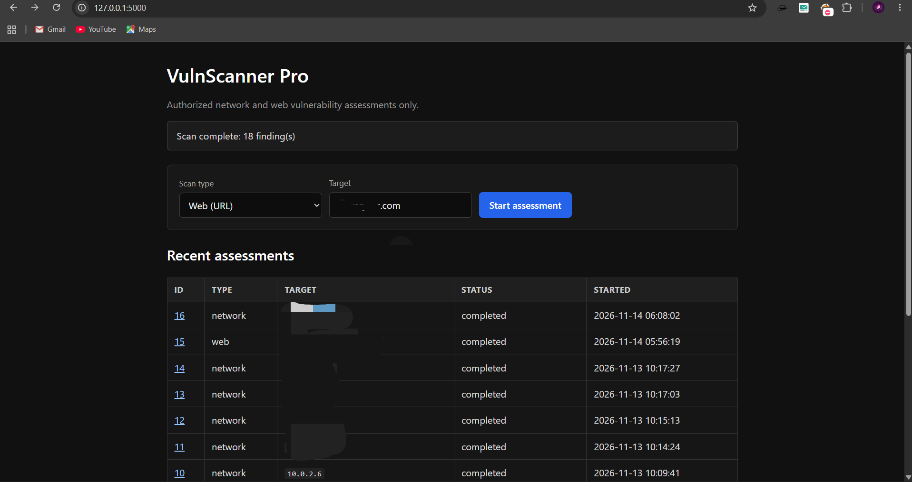
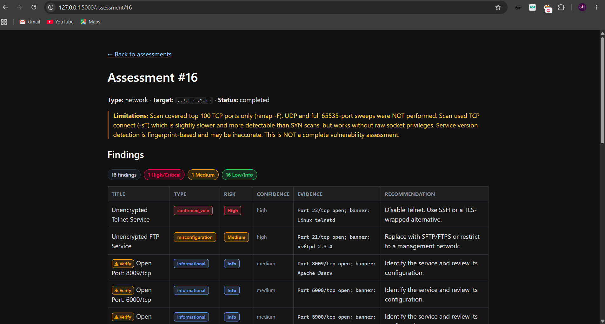
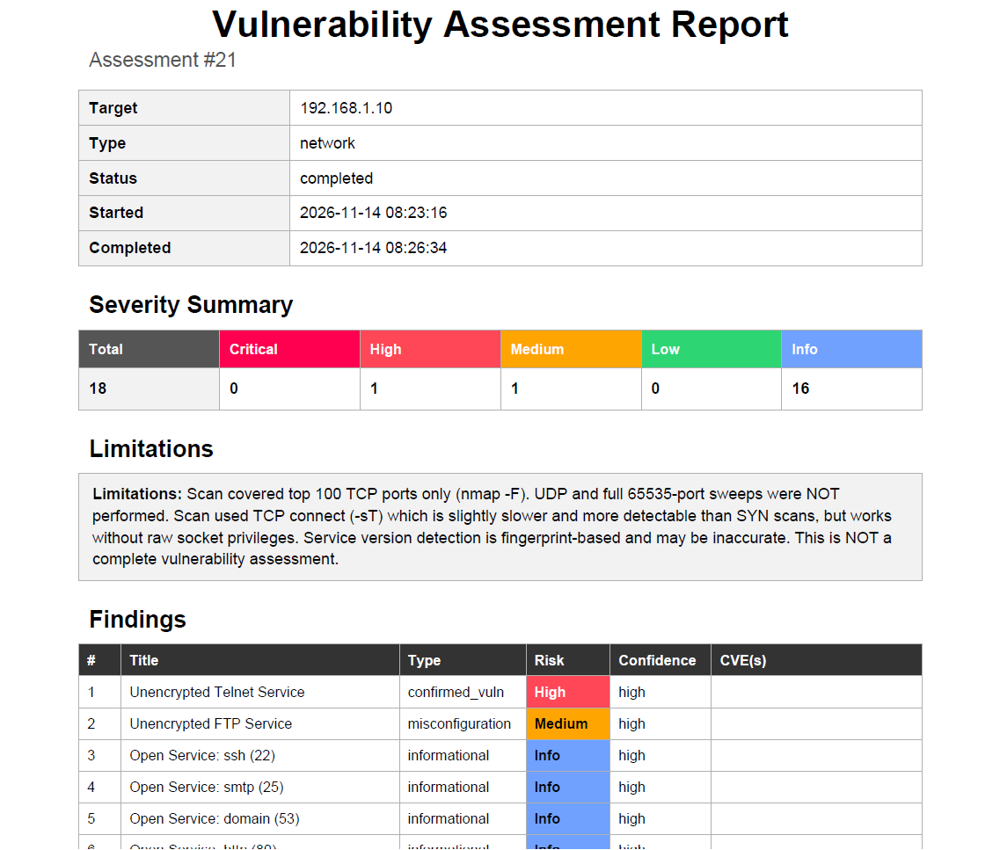

<div align="center">

# VulnScanner Pro

**A cinematic, evidence-based vulnerability assessment web application**

[](https://www.python.org/)
[](https://flask.palletsprojects.com/)
[](https://www.sqlite.org/)
[](https://github.com/)

</div>

> **Authorized use only.** VulnScanner Pro is intended for systems you own or
> have explicit written permission to assess. It is not a substitute for a
> professional penetration test.

## Screenshots

| Splash Screen | Home Dashboard |
| :---: | :---: |
|  |  |

| Results Page | PDF Report |
| :---: | :---: |
|  |  |

## Key Features

- **Network scanning with Nmap XML parsing** — Invokes Nmap with `-sT -sV -F`
  and parses the XML output directly, mapping open ports, services, products,
  and versions into normalized assets and findings.
- **Web security-header assessment** — Performs a TLS-verified HTTP request and
  evaluates missing `Content-Security-Policy`, `X-Frame-Options`, and HSTS
  headers as evidence-backed misconfigurations.
- **Evidence-based classification** — Every finding carries a type
  (`informational`, `misconfiguration`, `potential_vuln`, `confirmed_vuln`),
  risk level, confidence, technical reasoning, evidence, and remediation
  guidance. Findings are never fabricated to fill a report.
- **Real NIST NVD CVE integration** — Correlates product/version fingerprints
  with NVD 2.0 data using bounded concurrency, local SQLite caching, request
  throttling, retry-on-`429`/`503`, and graceful degradation when NVD is
  unavailable.
- **Automated PDF reporting** — Generates paginated, severity-color-coded
  reports in memory with assessment metadata, severity totals, limitations,
  findings tables, detailed evidence, recommendations, and CVE references.
- **Cinematic SOC / Doctor Doom UI** — A dark tactical interface with a
  full-screen splash, typewriter reveal, ash-dust transition, animated SOC HUD,
  and custom artwork.
- **Assessment history and deduplication** — Persists scans in SQLite and uses
  deterministic finding fingerprints to prevent duplicate findings within an
  assessment.
- **Hardened engineering defaults** — CSRF protection, security headers,
  parameterized SQL, argument-list subprocess execution, and target validation
  before persistence or scanner dispatch.

## Tech Stack

| Layer | Technology |
| --- | --- |
| Language | Python 3.10+ |
| Web framework | Flask 3.0, Flask-WTF |
| Persistence | SQLite |
| Network discovery | Nmap, `python-nmap`, `xml.etree.ElementTree` |
| Web checks | `requests` |
| Reporting | ReportLab |
| Frontend | HTML5, CSS3, vanilla JavaScript |
| Testing | pytest, pytest-cov, responses |

## Security Design

### SSRF-hardened input validation

All targets pass through `core/validator.py` before anything is persisted or
dispatched to a scanner.

- Rejects shell metacharacters and control characters.
- Normalizes and blocks legacy numeric IPv4 forms such as `2130706433` and
  `0177.0.0.1`.
- Rejects loopback, link-local, multicast, reserved, and unspecified addresses.
- Blocks cloud metadata endpoints and `.local` / `.internal` hostnames.
- Blocks private URL targets by default while allowing authorized private
  network ranges for network scans.
- Resolves hostnames with `socket.getaddrinfo()` and validates **every**
  resolved address to prevent DNS-based SSRF bypasses.
- Restricts web targets to HTTP(S), rejects embedded credentials, and verifies
  TLS certificates.

### Content Security Policy and browser hardening

Every response includes:

- `Content-Security-Policy` with explicit script, style, font, image, and
  connection origins.
- `X-Content-Type-Options: nosniff`
- `X-Frame-Options: DENY`
- `Referrer-Policy: no-referrer`

### Scanner separation

Network and web scanning live in independent modules with separate
limitations, evidence rules, and failure handling:

- `scanners/network_scanner.py` — Nmap execution, XML parsing, service
  classification, CVE enrichment.
- `scanners/web_scanner.py` — HTTP reachability and security-header checks.
- `core/validator.py` — single validation boundary shared by both paths.

This separation keeps scanner-specific logic isolated and makes the trust
boundary explicit: scanners receive only pre-validated targets.

### Additional controls

- CSRF protection on state-changing requests via Flask-WTF.
- Parameterized SQLite queries; no string-concatenated SQL.
- Nmap is invoked with an argument list and never through `shell=True`.
- NVD failures never fail an assessment; CVE correlation is enrichment only.
- Version-based CVE matches are always marked as potential findings requiring
  manual verification.

## Installation & Setup

### Prerequisites

- Python 3.10+
- Nmap installed locally
- Optional: a free NVD API key for higher CVE lookup rate limits

### 1. Clone the repository

```bash
git clone <repository-url>
cd vuln_scanner
```

### 2. Create and activate a virtual environment

```bash
python -m venv .venv
source .venv/bin/activate
```

On Windows PowerShell:

```powershell
python -m venv .venv
.\.venv\Scripts\Activate.ps1
```

### 3. Install dependencies

```bash
pip install -r requirements.txt
```

### 4. Configure Nmap

Install Nmap for your platform and set `NMAP_PATH` if it is not discoverable:

```bash
export NMAP_PATH="/usr/bin/nmap"        # Linux/macOS
export NMAP_PATH="C:\Program Files (x86)\Nmap\nmap.exe"  # Windows
```

### 5. Set the NVD API key

```bash
export NVD_API_KEY="your-nvd-api-key"
```

Without a key, NVD requests are throttled to roughly one every six seconds.
With a key, the interval drops to roughly 0.6 seconds.

### 6. Run the application

```bash
python app.py
```

Open <http://127.0.0.1:5000>. The SQLite database is created automatically on
first start.

### Configuration reference

| Variable | Default | Purpose |
| --- | --- | --- |
| `SECRET_KEY` | random per process | Flask session and CSRF signing |
| `DATABASE` | `scans.db` | SQLite database path |
| `NMAP_PATH` | platform-specific | Nmap executable |
| `NMAP_TIMEOUT` | `300` | Nmap timeout in seconds |
| `NVD_API_KEY` | unset | NVD API authentication |
| `NVD_CACHE_TTL_DAYS` | `7` | CVE cache lifetime |
| `BLOCK_PRIVATE_RANGES` | `true` | Block private addresses for URL targets |
| `LOG_LEVEL` | `INFO` | Application log level |
| `LOG_FILE` | `logs/app.log` | Rotating log destination |

## Testing

```bash
pytest tests/ -q
```

Current suite: **86 passing tests** covering validation/SSRF defenses, database
constraints, scanner behavior, API routes, CSRF, security headers, and PDF
generation.

With coverage:

```bash
pytest --cov=core --cov=scanners --cov=reports tests/
```

## Project Structure

```text
vuln_scanner/
├── app.py                      Flask routes, CSP, startup
├── config.py                   Environment-backed configuration
├── requirements.txt            Pinned dependencies
├── core/
│   ├── database.py             SQLite connection context manager
│   ├── models.py               Schema, constraints, and indexes
│   ├── validator.py            Target validation and SSRF defenses
│   └── logger.py               Console and rotating-file logging
├── scanners/
│   ├── network_scanner.py      Nmap execution, XML parsing, findings
│   ├── web_scanner.py          HTTP security-header assessment
│   └── cve_lookup.py           NVD lookup, caching, and rate limiting
├── reports/
│   └── pdf_generator.py        In-memory PDF report generation
├── static/
│   ├── style.css               SOC/Doom theme and splash animations
│   ├── js/splash.js            Cinematic splash sequence
│   ├── img/                    Background and splash artwork
│   └── video/                  Intro media
├── templates/
│   ├── index.html              Splash, SOC HUD, scan form, history
│   ├── findings.html           Assessment results and evidence
│   └── comparison.html         Comparison view
├── tests/                      Automated test suite
└── docs/screenshots/           README screenshots
```

## Limitations

VulnScanner Pro is deliberately honest about what it does and does not do:

- Network scans cover the **top 100 TCP ports only** (`nmap -F`). UDP and full
  65,535-port sweeps are not performed.
- The scanner uses TCP connect (`-sT`), which works without raw-socket
  privileges but is slower and more detectable than a SYN scan.
- Service and version detection are fingerprint-based and can be inaccurate.
- CVE matches are version-keyword correlations, not proof of exploitability,
  and require manual verification.
- Web findings reflect missing hardening headers, not confirmed exploits.
- Web scanning does not authenticate, crawl, inject payloads, or analyze
  JavaScript.
- Absence of findings does not mean a target is secure.
- This tool is **not** a full penetration test and does not replace manual
  security assessment.

## License

Released under the **MIT License**.
